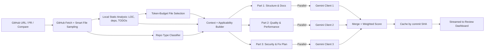

<div align="center">
  
  <h1>RepoRoast</h1>
  <p><strong>Paste a GitHub repo or PR. Get a brutally honest, grounded code review — scored, categorized, and backed by real static analysis.</strong></p>

  [](LICENSE)
  [](https://nodejs.org)
  [](server/tests/)
  [](CONTRIBUTING.md)

  [Live Demo](https://repo-roast-ai.vercel.app/) · [Architecture](ARCHITECTURE.md) · [Report Bug](https://github.com/Justinvcj/RepooRoast/issues) · [Request Feature](https://github.com/Justinvcj/RepooRoast/issues)
</div>

---

## Table of Contents

- [Why RepoRoast](#why-reporoast)
- [How It Works](#how-it-works)
- [Features](#features)
- [Live Demo Walkthrough](#live-demo-walkthrough)
- [Project Structure](#project-structure)
- [API Reference](#api-reference)
- [Quick Start](#quick-start)
- [Environment Variables](#environment-variables)
- [Tech Stack](#tech-stack)
- [Testing](#testing)
- [Known Limitations & Roadmap](#known-limitations--roadmap)
- [Architecture & System Design](#architecture--system-design)
- [Contributing](#contributing)
- [License](#license)
- [Acknowledgments](#acknowledgments)

---

## Why RepoRoast?

Most "AI code review" tools are thin wrappers that dump raw code into an LLM prompt and hope for the best. RepoRoast is built around three ideas instead:

1. **Ground the model in real signal before it writes a word.** The backend fetches repository metadata, the file tree, the README, and a budget-allocated sample of actual source files, then runs a local analysis pass (LOC, comment ratio, TODO/FIXME counts, import-based dependency graph — hub files, orphan files, circular dependency chains) *before* any AI call happens. The model reviews real file contents, not a vague summary.
2. **Classify the project before grading it.** A lightweight Gemini call first decides whether a repo is a personal portfolio, an open-source library, a CLI tool, a production service, a prototype, or a learning project. That classification drives two things: the *weights* used to combine category scores (`rubric-weights.json` — e.g. Test Coverage matters a lot more for a `production_service` than a `personal_portfolio`), and an **applicability matrix** (`applicability-rules.json`) that suppresses or downgrades findings that don't make sense for that project type (missing `SECURITY.md` on a portfolio site isn't a crime).
3. **Split the review into parallel, scoped requests.** Instead of one giant prompt trying to do everything, the review is decomposed into three concurrent Gemini requests — Structure & Docs, Code Quality & Performance, Security & Action Plan — then deep-merged and the overall score is computed as an explicit weighted average, not something the model freehands.

The tone is a deliberate "brutally honest senior engineer" roast — but the opinions are anchored to a strict 0–100 grading rubric embedded in the system prompt, so "brutal" doesn't mean "random."

---

## How It Works



Every stage of that pipeline is reported back to the browser as it happens — see [Live Demo Walkthrough](#live-demo-walkthrough).

---

## Features

- **Full-repo and PR/diff reviews.** Paste a plain repo URL (`github.com/owner/repo`), a Pull Request URL (`github.com/owner/repo/pull/123`), or a compare URL (`github.com/owner/repo/compare/base...head`) — the same engine handles both, with diff reviews scoped to the actual changed lines.
- **Budget-aware file sampling.** File selection scales with repo size (10% of eligible files, floored at 25 and capped at 60, plus a handful of always-included config files like `package.json`/`Dockerfile`), prioritizing entry points, routes/services/controllers, and high-centrality files from the dependency graph — instead of a fixed cap that would blind the review on large repositories. A token budget (`gpt-tokenizer`, 30k tokens) allocates more context to the most important files and truncates the rest, so the model always reviews *something real* from every selected file.
- **Honest sampling disclosure.** When a repo is too large to fully ingest, the prompt explicitly tells the model it's looking at a sample of N out of M files, so it calibrates broad claims (like "full test coverage") accordingly instead of generalizing from a slice.
- **Context-aware classification.** A dedicated Gemini call classifies the repo type and drives both the score weighting and an applicability matrix that suppresses irrelevant penalties.
- **Parallel, resilient LLM calls.** Three concurrent Gemini requests cut generation time roughly 3x versus one sequential call. Each request chain falls back across four model tiers (`gemini-3.7-flash` → `3.6` → `3.5` → `2.5-flash`) on a `503`/`429`/timeout, and every individual attempt is capped at 45 seconds so one stuck call can't hang the whole review.
- **Real-time progress, not a fake timer.** The server streams newline-delimited JSON progress events (`fetching` → `analyzing` → `classifying` → `generating`) over the same connection used for the result, so the loading screen reflects what the backend is actually doing — including a cache hit short-circuiting straight to 100%.
- **Commit-pinned response caching.** Reviews are cached in-memory by `repo:{owner}/{repo}:{commitSha}` (or `diff:{owner}/{repo}:{ref}`), so re-requesting the same commit returns in milliseconds without spending LLM quota.
- **Local dependency graph analysis.** Resolves relative imports across fetched files to compute hub files (imported by 3+ others), orphan files, and circular dependency chains — all done locally, with zero hallucination risk.
- **Auto-Fix prompt generator.** Every review ends with a single, CRED-structured prompt (Context / Role / Execute / Details) ready to paste into Claude, Cursor, or ChatGPT to fix the flagged issues.
- **Defense-in-depth on the API.** Strict CORS allowlisting, `helmet` security headers, per-IP rate limiting, request-body size caps, regex-validated GitHub URLs, prompt-injection fencing (untrusted repo content is wrapped in `<repository_data>`/`<diff_data>` tags with explicit instructions never to treat it as commands), and a 50KB-per-file size filter applied *before* downloading content to avoid memory blowups on huge files.
- **Zod-validated AI responses.** The expected JSON shape for a review (7 categories, scored 0–100, with issues/positives/suggestions) is defined as a Zod schema, and the parser strips markdown code fences or stray prose around the JSON before parsing.

---

## Live Demo Walkthrough

1. Paste a GitHub repo, PR, or compare URL into the input on the landing page.
2. The loading screen streams through the real pipeline stages — fetching, local analysis, classification, generation — each one lighting up as the server actually reaches it.
3. The result page opens with: an overall score (animated ring), a one-line verdict + hiring verdict, a bar-chart breakdown across 7 categories, sorted highest to lowest (Code Quality, Project Structure, Documentation, Security, Test Coverage, Performance, Scalability), expandable category cards with concrete issues (severity, file, description, suggested fix) and call-outs for what the repo did well, a "Top Priorities" action list, and a ready-to-copy Auto-Fix prompt.
4. A collapsible "Static Code Analysis" panel below the score shows the locally computed metrics directly — files parsed, LOC, comment ratio, dependency graph hubs/orphans, and per-file flags — independent of anything the AI said.

---

## Project Structure

```
RepooRoast/
├── client/                      # React 19 + TypeScript + Vite frontend
│   └── src/
│       ├── components/          # Hero, Navbar, ScoreCard, ScoreChart, CategorySection,
│       │                        # IssueCard, LoadingScreen, StaticAnalysisPanel, Lightfall, …
│       ├── hooks/
│       │   └── useRepoReview.ts # Streams the NDJSON response, drives review state + stage
│       ├── pages/                # HomePage, ResultPage
│       ├── contexts/             # LayoutContext (navbar/footer visibility during loading)
│       └── utils/                # githubParser, scoreHelpers
│
├── server/                      # Node.js + Express 5 backend
│   └── src/
│       ├── routes/
│       │   └── review.js        # POST /api/review, POST /api/review/diff (NDJSON streaming)
│       ├── services/
│       │   ├── githubService.js     # GitHub fetch, smart file selection, diff fetching
│       │   ├── classifierService.js # Repo-type classification (12s timeout, graceful fallback)
│       │   ├── geminiService.js     # Parallel 3-part review generation + score aggregation
│       │   └── cacheService.js      # In-memory, commit-SHA-keyed response cache
│       ├── analyzers/
│       │   ├── staticAnalyzer.js    # Orchestrates per-file analysis + dependency graph
│       │   ├── genericAnalyzer.js   # Regex-based LOC/comment/import/function-name extraction
│       │   ├── jstsAnalyzer.js      # Tree-sitter AST walker (cyclomatic complexity, nesting,
│       │   │                        # magic numbers) — see note in Known Limitations
│       │   ├── pythonAnalyzer.js    # Tree-sitter AST walker for Python
│       │   └── graphResolver.js     # Import resolution + hub/orphan/cycle detection
│       ├── budget/
│       │   ├── budgetAllocator.js   # Token-budget file content allocation
│       │   ├── fileScorer.js        # Scores files by path pattern + import centrality
│       │   └── tokenCounter.js      # gpt-tokenizer wrapper (count + truncate)
│       ├── middleware/
│       │   ├── inputValidator.js    # Regex validation for repo/PR/compare URLs
│       │   └── errorHandler.js      # Sanitizes error messages in production
│       ├── utils/
│       │   ├── promptBuilder.js     # Builds the 3 scoped prompts + applicability context
│       │   └── responseParser.js    # JSON extraction/cleanup + Zod schema
│       └── config/
│           ├── rubric-weights.json       # Per-repo-type category weights
│           └── applicability-rules.json  # Per-repo-type issue suppression/downgrade rules
│
├── ARCHITECTURE.md              # Deep technical design notes
├── PRD.md                       # Product requirements
└── CONTRIBUTING.md
```

---

## API Reference

All endpoints are mounted under `/api/review` and rate-limited to 10 requests per 15 minutes per IP.

### `POST /api/review`

Full-repository review.

```json
{ "repoUrl": "https://github.com/owner/repo" }
```

### `POST /api/review/diff`

PR or compare review.

```json
{ "owner": "owner", "repo": "repo", "pullNumber": "123" }
```
```json
{ "owner": "owner", "repo": "repo", "compareString": "main...feature-branch" }
```

### Response format (both endpoints)

The response is **streamed**, not buffered: zero or more newline-delimited progress events, followed by one final result (or error) object.

```
{"type":"progress","stage":"fetching"}
{"type":"progress","stage":"analyzing"}
{"type":"progress","stage":"classifying"}
{"type":"progress","stage":"generating"}
{"success":true,"repo":{...},"analysis":{...},"review":{...}}
```

`stage` is one of `fetching`, `analyzing`, `classifying`, `generating`, or `cache_hit` (cache hits skip straight to the final object). On failure the final line is `{"success":false,"error":"..."}` instead. The same mechanism doubles as a keepalive heartbeat during long Gemini generations, so there's no separate ping protocol to implement on the client.

### `GET /health`

Returns `{ "status": "OK" }` — no auth, no rate limit, for uptime checks.

---

## Quick Start

### Prerequisites

| Requirement | Why It's Needed |
|---|---|
| [Node.js 18+](https://nodejs.org) | Runtime engine for client and server |
| [Gemini API Key](https://aistudio.google.com/apikey) | Powers the AI review synthesis (free tier supported) |
| [GitHub Token](https://github.com/settings/tokens) | *(Optional)* Increases GitHub API rate limits to 5,000 req/hr |

### Run Locally

```bash
# 1. Clone the repository
git clone https://github.com/Justinvcj/RepooRoast.git
cd RepooRoast

# 2. Set up and run the backend (Terminal 1)
cd server
npm install
cp .env.example .env
# edit .env and add your GEMINI_API_KEY
npm run dev
# Server starts on http://localhost:3001

# 3. Set up and run the frontend (Terminal 2)
cd ../client
npm install
npm run dev
# Client starts on http://localhost:5173, proxying /api to the server
```

`npm run dev` on the server uses `nodemon` for auto-restart; use `npm start` for a plain `node` run in production.

---

## Environment Variables

### Server (`server/.env`)

| Variable | Required | Default | Description |
|---|---|---|---|
| `GEMINI_API_KEY` | **Yes** | — | Primary Google AI Studio API key |
| `GEMINI_API_KEY_2` | No | falls back to `GEMINI_API_KEY` | Second key, used by one of the 3 parallel review clients |
| `GEMINI_API_KEY_3` | No | falls back to `GEMINI_API_KEY` | Third key, used by the remaining parallel review client |
| `GITHUB_TOKEN` | No | — | GitHub Personal Access Token (raises API rate limit from 60/hr to 5,000/hr; also required in practice for any repo with more than a handful of files, since the smart file sampler makes one GitHub API request per selected file) |
| `PORT` | No | `3001` | Express server port |
| `NODE_ENV` | No | `development` | In `production`, generic 500 errors are masked before reaching the client |

### Client

| Variable | Required | Default | Description |
|---|---|---|---|
| `VITE_API_URL` | No | `''` (same-origin, proxied by Vite in dev) | Override if the API is hosted on a different origin than the client in production |

---

## Tech Stack

| Layer | Technology |
|---|---|
| **Frontend** | React 19, TypeScript, React Router 7, Tailwind CSS, Framer Motion, Vite, OGL (WebGL background), `react-hot-toast` |
| **Backend** | Node.js, Express 5, Axios, Helmet, Morgan, `express-rate-limit`, Zod |
| **Local Analysis** | Custom regex-based LOC/comment/import extraction + import-graph resolution (`graphResolver.js`); `web-tree-sitter` AST walkers exist in-repo for deeper JS/TS/Python metrics (see [Known Limitations](#known-limitations--roadmap)) |
| **Token Budgeting** | `gpt-tokenizer` (`cl100k_base` encoding) for counting and truncating file content to a fixed budget |
| **AI Backbone** | Google Gemini, via `@google/generative-ai`, with a 4-tier model fallback chain and per-attempt timeouts |
| **Testing** | Vitest, with HTML reporting (`npm run test:report`) |

---

## Testing

```bash
cd server
npm test
```

The suite (`server/tests/`) covers:

- `budget.test.js` — token-budget file allocation logic
- `cacheService.test.js` — commit-SHA cache set/get/expiry lifecycle
- `githubPruning.test.js` — file-selection/ignore-pattern logic
- `integration.test.js` — a real end-to-end GitHub fetch + AST parse (skips its assertions gracefully if the GitHub API is rate-limited)
- `jstsAnalyzer.test.js` — the tree-sitter AST walker's complexity/nesting/flag output
- `responseParser.test.js` — JSON extraction from markdown-fenced/noisy LLM output
- `security.test.js` — input validation and prompt-injection fencing boundaries

There is no frontend test suite yet (`@playwright/test` is installed as a dev dependency but not wired into a script — see [Known Limitations](#known-limitations--roadmap)).

---

## Known Limitations & Roadmap

Documented here deliberately, instead of only in commit history, so the gap between "what the code aspires to" and "what's actually running" is visible:

- **Deep AST analysis is currently dormant in production.** `jstsAnalyzer.js` and `pythonAnalyzer.js` implement full tree-sitter-based cyclomatic complexity, max nesting depth, parameter counts, and magic-number detection, and are covered by tests — but `staticAnalyzer.js` currently routes every file through the lightweight `genericAnalyzer.js` regex fallback instead, to avoid WASM memory pressure on constrained hosting. The dependency graph (hubs/orphans/cycles) still works today since it only needs import statements, which the regex fallback does extract. Re-enabling the tree-sitter path (with a WASM memory guard) is the single highest-leverage next step for review accuracy.
- **In-memory cache only.** `cacheService.js` is a `Map` with a 100-entry LRU-ish eviction and a 24h TTL — it resets on every server restart/redeploy and doesn't share state across multiple server instances. A Redis-backed cache would fix both.
- **Large repositories are sampled, not fully ingested.** File selection scales with repo size but is still capped (60 files) for cost and latency reasons; the prompt now discloses this to the model, but a truly huge monorepo will still only get a representative slice reviewed.
- **No Playwright suite wired up yet**, despite the dependency being present — frontend behavior is currently verified manually.
- **Classifier and review generation depend on Gemini API availability.** Both paths have timeouts and fall back gracefully (to `unknown` classification, or the next model tier) rather than hanging, but a full Gemini outage will degrade review quality or fail the request entirely — there's no non-LLM fallback for the review itself.

---

## Architecture & System Design

For deeper detail on AST traversal, the mathematical scoring algorithm, and security sandboxing, see [ARCHITECTURE.md](ARCHITECTURE.md).

---

## Contributing

Contributions are welcome! Please read [CONTRIBUTING.md](CONTRIBUTING.md) before submitting a pull request.

---

## License

This project is licensed under the [MIT License](LICENSE).

---

## Acknowledgments

- [`web-tree-sitter`](https://github.com/tree-sitter/tree-sitter) for WASM AST parsing capabilities.
- [`Google Gemini`](https://ai.google.dev/) for the review synthesis.
- [`gpt-tokenizer`](https://www.npmjs.com/package/gpt-tokenizer) for token budget allocation.
- [ReactBits](https://reactbits.dev) for the Lightfall animated background component.
